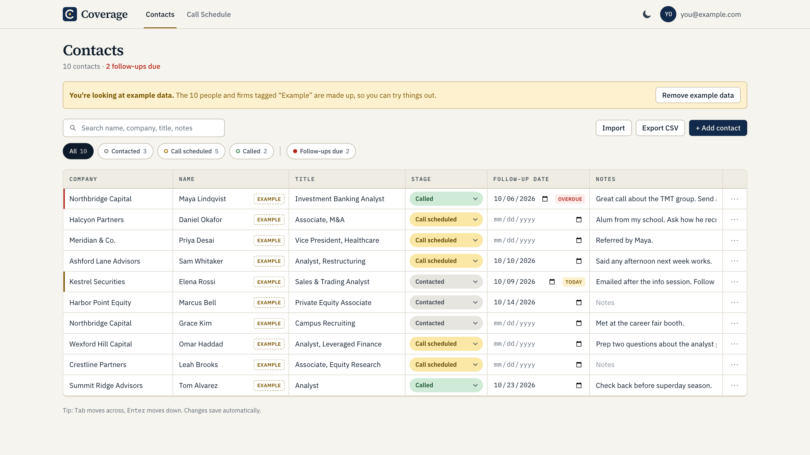
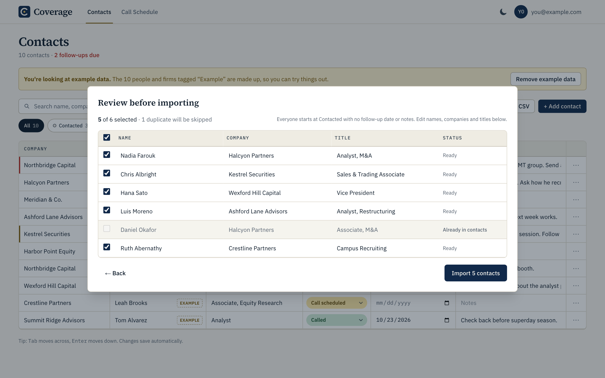
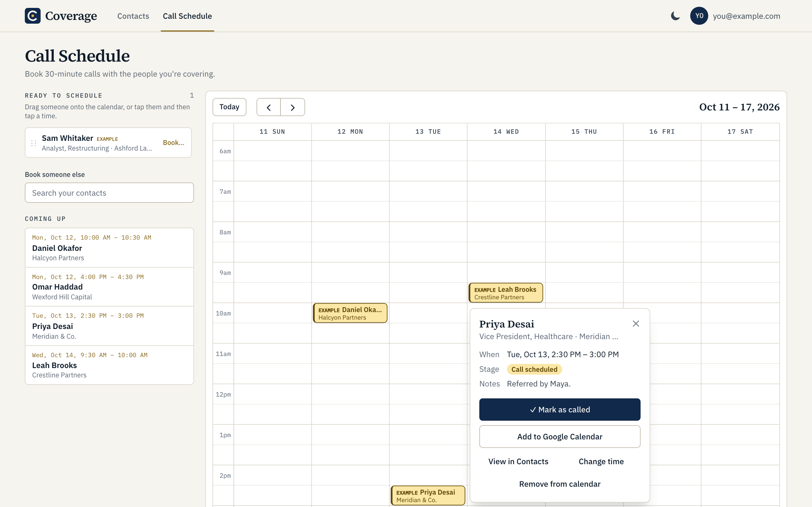
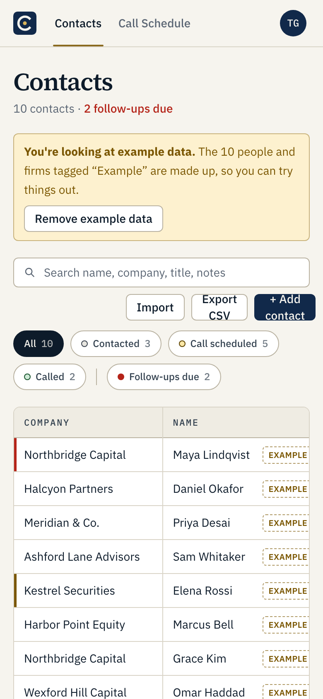
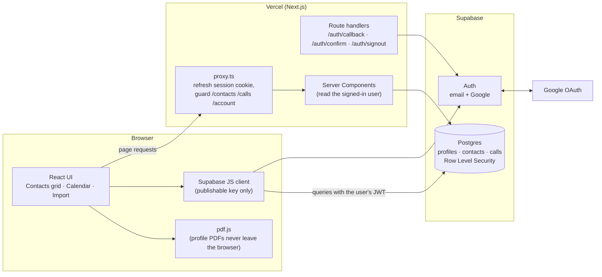

# Coverage

Coverage is a list for your recruiting season: every banker, alum, and recruiter you’re talking to, where each conversation stands, and the calls on your calendar.

**Cover your network.** A private networking tracker for college students recruiting for internships: a
spreadsheet-style contact grid plus a weekly call calendar.

**Live demo:** https://coverage-green.vercel.app · sign up free, then click **Try with example data**.

[](https://github.com/tfinn18/coverage/actions/workflows/ci.yml)



| Import from LinkedIn, with a review step | Book calls on a weekly calendar |
| --- | --- |
|  |  |

<p align="center"></p>

## What it does

- **Contacts grid.** Company, Name, Title, Stage, Follow-up date, Notes. Cells are editable like a spreadsheet
  (Tab across, Enter down) and auto-save. Sort any column, search, filter by stage or "Follow-ups due"; overdue and
  due-today rows are flagged. Delete with undo, CSV export.
- **Notes for every contact.** "Open notes" opens a side panel (half the screen on desktop, full screen on a phone)
  with a structured document: Prep (their background, why this firm, numbered questions), Call notes (date, key
  advice, the firm, people to contact, what you asked for), and Follow-up (a thank-you email you can copy or open in
  your email app, a "Thank-you sent" date, next steps).
- **Stages.** Contacted (grey) → Call scheduled (yellow) → Called (green).
- **LinkedIn import, without scraping.** Drop profile PDFs saved with LinkedIn's *More → Save to PDF* (parsed in the
  browser), upload `Connections.csv` from LinkedIn's data export (or any tracker CSV), or paste profile URLs. Every
  import goes through an editable review table that skips duplicates.
- **Call Schedule.** A Google Calendar-style week view. Drag anyone at "Call scheduled" from the *Ready to schedule*
  panel onto a 30-minute slot (or tap them, then tap a slot on a phone). Drag calls to move them. Click a call to mark
  it as called, add it to Google Calendar, or jump to the contact.
- **Accounts.** Email + password or Google sign-in, email confirmation, password reset, account settings, and
  "Delete my account" that removes everything.
- **Polish.** Light and dark mode, responsive down to phone width, keyboard accessible, example data for new users.

## Tech stack

All free tiers; no paid APIs.

| Layer | Choice |
| --- | --- |
| Framework | [Next.js 16](https://nextjs.org) (App Router, Cache Components) · React 19 · TypeScript |
| Styling | Tailwind CSS v4 with design tokens · IBM Plex Sans/Mono + Source Serif 4 |
| Auth + database | [Supabase](https://supabase.com): Auth (email, Google OAuth) and Postgres with Row Level Security |
| Calendar | [FullCalendar](https://fullcalendar.io) v6 (MIT core: timeGrid + interaction) |
| PDF parsing | [pdf.js](https://mozilla.github.io/pdf.js/) (`pdfjs-dist`), lazy-loaded, runs in the browser |
| Testing | Vitest (unit + RLS isolation) · Playwright + axe-core (end-to-end + accessibility) |
| CI / hosting | GitHub Actions · Vercel Hobby |

## Architecture



Most reads and writes go **directly from the browser to Postgres** with the user's session token. There is no custom
API layer to secure: the database decides what each request may see.

### Data model

| Table | Columns |
| --- | --- |
| `profiles` | `id` → `auth.users`, `full_name`, `created_at` (created by a trigger on sign-up) |
| `contacts` | `id`, `user_id`, `company`, `name`, `title`, `stage` (`contacted` \| `call_scheduled` \| `called`), `follow_up_date`, `notes`, `linkedin_url`, `is_example`, `created_at`, `updated_at` |
| `calls` | `id`, `user_id`, `contact_id` → `contacts`, `starts_at`, `duration_minutes` (default 30) |
| `contact_notes` | `contact_id` → `contacts` (one per contact), `user_id`, `doc` (JSON notes document), `updated_at` |

`contacts` also has an optional `email`. `contacts.notes` holds a plain-text copy of the notes document so the grid
preview, search, and CSV export never need to load every document.

Every foreign key to `auth.users` is `on delete cascade`, so deleting an account removes all of its data. SQL lives in
[`supabase/migrations`](supabase/migrations).

## Security model

- **Row Level Security on every table.** Separate `select` / `insert` / `update` / `delete` policies require
  `auth.uid() = user_id` (or `= id` for profiles). Logged-out requests match no policy. The `calls` insert/update
  policies (and the same policies on `contact_notes`) also check that the linked contact belongs to the same user, so
  you can't attach a call or notes to someone else's contact. ([`0002_rls.sql`](supabase/migrations/0002_rls.sql))
- **No service role key anywhere.** The app, scripts, and tests use only the publishable (anon) key. The one
  admin-like action, "Delete my account", is a `security definer` function that can only delete the caller's own
  `auth.users` row. ([`0003_functions.sql`](supabase/migrations/0003_functions.sql))
- **Proven by a test.** [`tests/rls/isolation.test.ts`](tests/rls/isolation.test.ts) signs in as two ordinary users and
  checks that user B can't read, update, delete, or insert into user A's contacts, calls, notes, or profile, and that
  logged-out requests see nothing.
- **Sessions.** `@supabase/ssr` keeps the session in HTTP cookies; `proxy.ts` validates the JWT (`getClaims`) on each
  request. Server code never trusts an unverified session.
- **Safe redirects.** `?next=` values pass through `safeNextPath()`, which rejects absolute and protocol-relative URLs
  (no open redirects). Log out is POST-only.
- **CSV export** escapes cells that start with `=`, `+`, `-`, or `@` so a malicious name can't run a spreadsheet
  formula.
- **Privacy by design.** LinkedIn PDFs are parsed in the browser and never uploaded. Coverage never scrapes LinkedIn or
  calls unofficial APIs; it only reads files and links the user provides.
- **Secrets.** `.env.local` is git-ignored; [`.env.example`](.env.example) documents every variable.

## Run it locally

You need Node.js 24+ and a free Supabase project.

```bash
git clone https://github.com/tfinn18/coverage.git
cd coverage
npm install
cp .env.example .env.local     # add your Supabase URL and publishable key
npm run dev                    # http://localhost:3000
```

1. **Database:** in the Supabase SQL Editor, run the files in `supabase/migrations/` in order (0001 → 0005).
2. **Auth URLs:** in Supabase → Authentication → URL Configuration, set the Site URL and add
   `http://localhost:3000/**` to Redirect URLs.
3. **Google sign-in (optional):** create an OAuth client (Web application) in Google Cloud, add
   `https://<project-ref>.supabase.co/auth/v1/callback` as an authorized redirect URI, and paste the client ID and
   secret into Supabase → Authentication → Sign In / Providers → Google.

### Tests

| Command | What it checks |
| --- | --- |
| `npm run lint` · `npm run typecheck` | ESLint and TypeScript |
| `npm test` | 56 unit tests: CSV and PDF parsers (with fixture files), import mapping and duplicate detection, sort/filter, follow-up flags, scheduling helpers, Google Calendar links, the notes document and its list editing, mailto links, safe redirects |
| `npm run test:rls` | 8 checks that one user can't touch another's rows, including notes (needs two test accounts in `.env.local`) |
| `npm run test:e2e` | Playwright: sign in, add a contact, reload, see it on the calendar, delete it; write and reopen notes (Enter/Backspace lists, Copy, Open in email, Escape); the notes sheet at phone width; plus axe WCAG 2.1 AA scans of 8 pages and the open notes panel in light and dark mode. `E2E_BASE_URL=https://coverage-green.vercel.app` runs it against production |

GitHub Actions runs lint, typecheck, unit tests, and a production build on every push. The RLS and end-to-end suites
need real credentials, so they run locally.

## Project structure

```
src/
  app/                  routes: landing, privacy, (auth) pages, (app) pages, auth route handlers
  components/           ui primitives, contacts grid, import dialog, calls calendar
  lib/                  framework-free logic (unit-tested): contacts, csv, pdf, linkedin, import, calls
  lib/supabase/         browser client, server client, session proxy
  proxy.ts              route guard (Next.js 16's name for middleware)
supabase/migrations/    schema, RLS policies, functions
tests/                  unit tests, fixtures, RLS isolation test
e2e/                    Playwright end-to-end and accessibility tests
```

## What I learned / design decisions

> A starting point for interviews and resume bullets. Edit it into your own words.

- **Let the database enforce privacy.** Instead of writing an API that checks ownership on every endpoint, I put Row
  Level Security policies on each table and let the browser query Postgres directly. The security rule lives in one
  place, and I wrote a test that signs in as two users to prove it holds.
- **No admin keys in the app.** Deleting an account normally needs Supabase's service role key. I used a narrowly scoped
  `security definer` SQL function instead, so no secret key exists in the codebase or on Vercel.
- **Respect the platform's rules.** LinkedIn prohibits scraping, so imports only use what users export themselves
  (Save to PDF, the data-export CSV, a pasted URL). The PDF parser reads text positions and font sizes with pdf.js:
  the largest text on the page is the name, and the first entry under "Experience" is the current job, including the
  case where one company lists several roles.
- **Make it feel like a spreadsheet.** Edits update the screen instantly and save in the background with a debounce,
  merging rapid edits to the same row and retrying failures. Rows don't re-sort while you type, which is easy to get
  wrong.
- **Design for 1,000+ rows.** The CSV parser is a single-pass RFC 4180 parser, and the import review table only renders
  the rows on screen, so a 1,500-connection file opens in about 30 ms.
- **Accessibility is testable.** Every drag-and-drop action has a keyboard or tap alternative, and automated axe scans
  run on every page in both themes. They caught real contrast and labeling bugs.
- **Pure logic, small components.** Parsing, filtering, and scheduling live in plain TypeScript modules with no React,
  which is what made them easy to unit test.
- **Built with an AI pair programmer.** I used Claude Code to scaffold and implement the app while I made the product
  and security decisions, tested each phase in the browser, and handled deployment. `CLAUDE.md` records the
  conventions it followed.

**Resume bullets (examples):**

- Built and deployed *Coverage*, a full-stack networking tracker (Next.js, TypeScript, Supabase Postgres) with
  spreadsheet-style editing, LinkedIn PDF/CSV import, and a drag-and-drop call calendar.
- Secured multi-user data with Postgres Row Level Security and verified isolation with an automated two-user test; no
  privileged keys in the app.
- Wrote 75+ automated tests (Vitest, Playwright, axe accessibility scans) and set up GitHub Actions CI on every push.

## Known limitations

### Email links must be opened in the same browser

Supabase's free plan only allows editing the auth email templates once you configure a custom SMTP
server, so Coverage uses Supabase's **default** confirmation and password-reset emails.

Those default emails use the PKCE flow: the link carries a one-time `code` that can only be exchanged
for a session in the **same browser** that requested the email (a secret "code verifier" is stored there).
What that means in practice:

- **Sign-up confirmation:** opening the link in the same browser signs you straight in. Opening it on
  another device or browser still confirms the email, but doesn't sign you in; you land on the log-in page
  with a note to log in, which works normally.
- **Password reset:** the link must be opened in the browser where you clicked "Send reset link".
  Otherwise you'll be asked to request a new link.
- **Email rate limit:** Supabase's built-in email sender only sends a few emails per hour per project.
  That's fine for a portfolio project, but a real launch would need custom SMTP.

**How to remove the limitation:** add custom SMTP in Supabase (Authentication → Emails → SMTP Settings;
a free tier from a provider like Resend or Brevo works), then change the two templates so their links
use a `token_hash`, which `/auth/confirm` already supports on any device:

```html
<!-- Confirm signup -->
<a href="{{ .RedirectTo }}?token_hash={{ .TokenHash }}&type=email">Confirm your email</a>
<!-- Reset password -->
<a href="{{ .RedirectTo }}&token_hash={{ .TokenHash }}&type=recovery">Reset your password</a>
```

(The reset link uses `&` because its redirect URL already contains `?next=/reset-password`.)

### Other notes

- **Free Supabase projects pause** after about a week without activity. Restore the project from the Supabase
  dashboard; no data is lost.
- **LinkedIn PDF layouts** can change. The parser is tested against fixtures that mimic the current export; if a field
  isn't found, the review step flags it so you can type it in.
